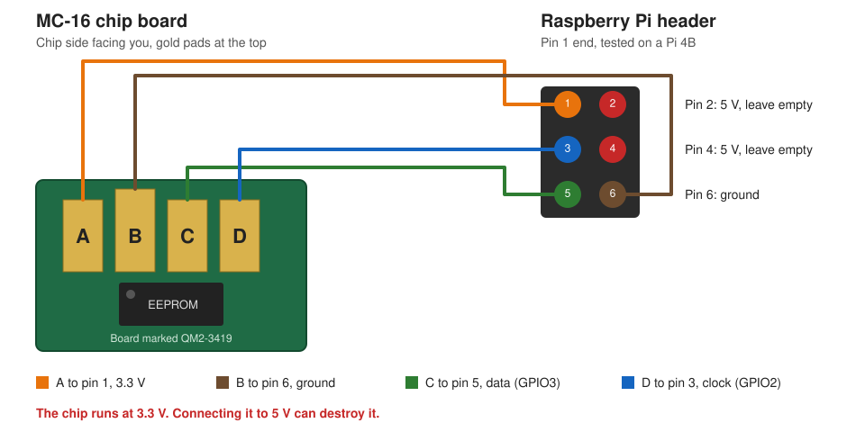
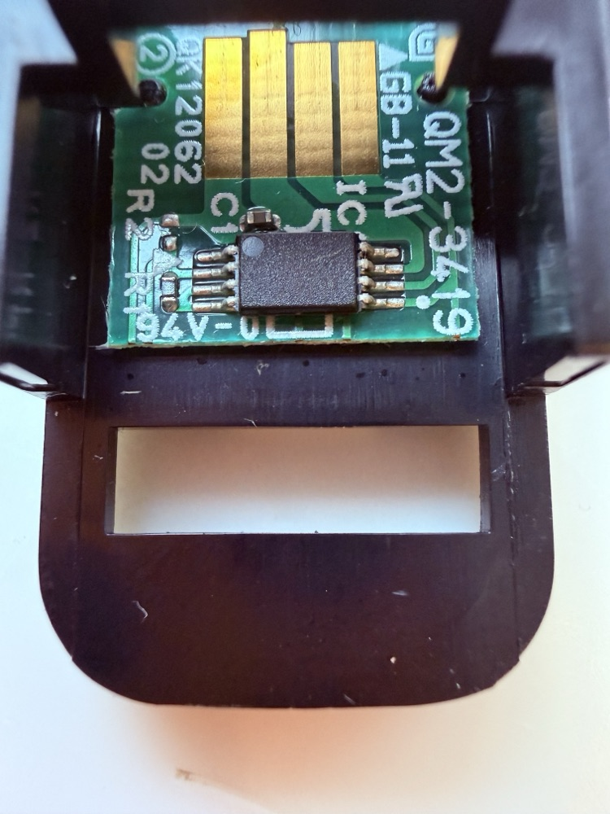
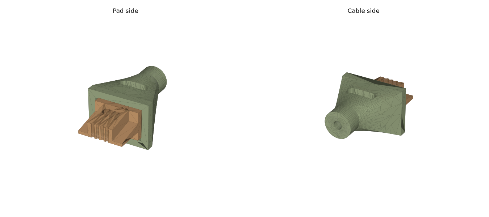

# Canon iPF MC-16 maintenance cartridge chip reset

Write this image to the chip and the plotter treats the cartridge as new.

Tested on an iPF6450 with an MC-16 cartridge at 0% free. The plotter accepted the chip on insertion, showed 100% free, ran its printhead cleaning and began counting again. It read 80% free after that cleaning.

Empty the absorber first. The counter restarts at zero, and the plotter uses that count to decide when the cartridge is full. Waste ink is conductive and can damage the plotter if the cartridge overflows.

## The image

The chip is a 256-byte EEPROM at I2C address `0x51` and runs at 3.3 V. Every byte is `00` except these four:

| Address | Value |
|---|---|
| `0x7D` | `55` |
| `0x7E` | `AA` |
| `0xFE` | `FF` |
| `0xFF` | `FF` |

[`mc16-new.bin`](mc16-new.bin) is this image. SHA-256: `2f9c5b7eda3e109a561d8f22fb384e103d2164b6b7da62eb685e0945a756d175`

The image comes from a [2015 Copytechnet post](https://www.copytechnet.com/forum/technical-forums/copier-technical-discussion/canon-aa/103774-everything-i-know-about-mc-08-maintenance-cartridge) by the user lan, who was working on an iPF8000 with an MC-08.

## Pinout



| Pad, left to right | Signal | Pi pin |
|---|---|---|
| A | 3.3 V | 1 |
| B, the longest pad | Ground | 6 |
| C | Data | 5 (GPIO3) |
| D | Clock | 3 (GPIO2) |

Pi pins 2 and 4 sit right next to these and carry 5 V. Keep the wires off them.



## Reset steps

1. Empty and dry the absorber.
2. Take the chip board off the cartridge.
3. On the Pi, install the GPIO library and copy over `mc16chip.py` and `mc16-new.bin`:

   ```bash
   sudo apt install python3-lgpio
   ```

4. Boot the Pi, then connect the plug to the Pi and press it onto the pads. One boot failed with the harness already attached.
5. Check the chip, save a backup and write the image:

   ```bash
   sudo python3 mc16chip.py probe
   sudo python3 mc16chip.py read backup.bin
   sudo python3 mc16chip.py write mc16-new.bin
   ```

   The write ends with `write verified`. If the chip stops answering, reseat the plug on the pads and run the command again.
6. Put the board back on the cartridge and insert it. The plotter can stay on. Let any cleaning cycle finish.

The script tries both data line orders, so swapped C and D wires still work. It was tested on a Pi 4B.

The image was written to the real chip with the bus code this script is built from. The combined script has been tested against a simulated EEPROM.

## 3D printed plug



The plug holds four wires against the chip pads. It was designed in Onshape.

| File | Size (mm) |
|---|---|
| [`plug/part1-contact-block.stl`](plug/part1-contact-block.stl) | 14.9 x 11.5 x 9.5 |
| [`plug/part3-cable-shell.stl`](plug/part3-cable-shell.stl) | 20.7 x 22.5 x 15.3 |
| [`plug/part4-insert.stl`](plug/part4-insert.stl) | 8.7 x 2.2 x 5.5 |

[`plug/mc16-chip-plug.3mf`](plug/mc16-chip-plug.3mf) has all three parts in position.

## If the cartridge still has 20% or more

You may not need any of this. Owners report that the plotter's service mode can reset the counter at 20% remaining or above, though not below it ([iPF6300 report](https://forum.luminous-landscape.com/index.php?topic=22259), [iPF6400 steps](https://www.farbenwerk.com/en/blogs/news/reset-canon-mc-16)).

1. Hold Load and Navigate while powering on, until "Initializing" appears. An "S" shows at the top right.
2. Open the Set./Adj. Menu, then SERVICE MODE.
3. Go to INITIALIZE, then W-INK, and press OK. Leave `W-INK-CHG CNT` alone.
4. Power off, then power on normally.

## Other models

Resellers list the MC-05 through MC-10 and MC-16 chips together, and the image was first published for an MC-08. Only the iPF6450 with an MC-16 has been tested here. Keep your backup in case your model rejects the image.

This project is not affiliated with Canon. Use it at your own risk.
